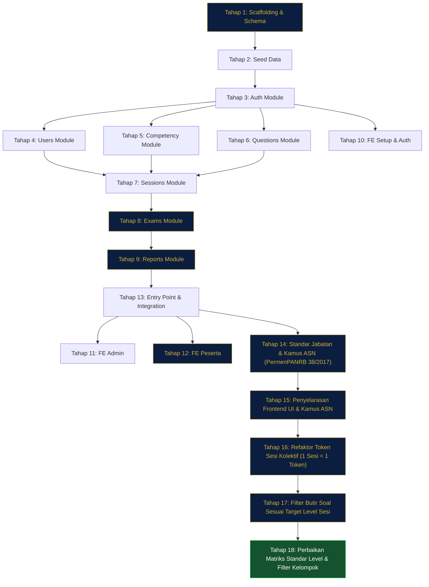

# Rencana TDD — Aplikasi Asesmen ASN (SJT)

> **Stack**: Bun 1.4 · ElysiaJS · SvelteKit (Svelte 5) · MySQL · Drizzle ORM  
> **Test Runner**: `bun test` (built-in, Vitest-compatible API)  
> **Dokumen Acuan**: [assessment_app_spec.md](file:///C:/Users/user/.gemini/antigravity-ide/brain/0df2bc95-e3be-417a-92a1-0c5cba4f89cf/assessment_app_spec.md)

Setiap tahap di bawah ini dirancang sebagai **1 GitHub Issue** yang berdiri sendiri. Urutan eksekusi **wajib sekuensial** — tahap berikutnya bergantung pada output tahap sebelumnya.

---

## Tahap 1: Project Scaffolding & Database Schema

**Ringkasan Tugas**  
Inisialisasi monorepo (backend + frontend), konfigurasi Bun workspace, setup Drizzle ORM dengan koneksi MySQL, dan definisikan seluruh tabel database sesuai spesifikasi. Sertakan migration runner dan konfigurasi environment.

**Target File**
- Kode Fitur: `backend/src/db/schema.ts`, `backend/src/db/connection.ts`, `backend/drizzle.config.ts`, `backend/package.json`
- Kode Uji: `backend/tests/db/schema.test.ts`

**Kode Test Suite (Wajib Berisi Skenario Sukses & Edge Case)**
```typescript
// backend/tests/db/schema.test.ts
import { describe, it, expect } from "bun:test";

describe("Database Schema Definitions", () => {
  it("should export all 7 required tables", () => {
    // Pastikan schema.ts mengekspor: users, competencies, questions,
    // questionOptions, assessmentSessions, sessionParticipants, participantAnswers
  });

  it("users table should have correct columns and constraints", () => {
    // Validasi kolom: id (PK auto-increment), nip (unique varchar), nama, email,
    // password_hash, role (enum ADMIN/PESERTA), jabatan, instansi, unit_kerja,
    // jenjang_jabatan (enum PELAKSANA/PENGAWAS/ADMINISTRATOR/JPT), created_at
  });

  it("competencies table should support 9 kompetensi with kategori enum", () => {
    // Validasi kolom: id, kode (unique), nama, kategori (enum MANAJERIAL/SOSIO_KULTURAL),
    // deskripsi, bobot_standar
  });

  it("questions table should have FK to competencies", () => {
    // Validasi: competency_id FK, kode_soal, skenario_kasus (text), target_level (1-4)
  });

  it("question_options should enforce 4 options with bobot 1-4", () => {
    // Validasi: question_id FK, label (A/B/C/D), teks_opsi, bobot_nilai (tinyint 1-4)
  });

  it("assessment_sessions should have status enum and duration", () => {
    // Validasi: status (DRAFT/BERJALAN/SELESAI), durasi_menit, target_jenjang, kode_sesi (unique)
  });

  it("session_participants should track exam state and scoring", () => {
    // Validasi: session_id FK, user_id FK, token_akses, status enum,
    // tab_switch_count, total_score, jpm_percentage, kategori_kelulusan
  });

  it("participant_answers should link participant to selected option", () => {
    // Validasi: session_participant_id FK, question_id FK, selected_option_id FK,
    // bobot_diperoleh, is_ragu (boolean), updated_at
  });
});
```

**Acceptance Criteria**
- [ ] `bun install` berhasil di root dan `backend/`
- [ ] `drizzle-kit generate` menghasilkan migration SQL tanpa error
- [ ] Semua test di `schema.test.ts` pass (RED → GREEN)
- [ ] File `.env.example` tersedia dengan variabel `DATABASE_URL`

---

## Tahap 2: Seed Data — Kompetensi, Bank Soal SJT & User Demo

**Ringkasan Tugas**  
Buat seeder yang mengisi database dengan 9 dimensi kompetensi PermenPANRB, minimal 18 soal SJT (2 per kompetensi) dengan 4 opsi berbobot 1-4, dan akun demo (1 Admin, 3 Peserta ASN berbagai jenjang). Seeder harus idempotent (aman dijalankan berulang).

**Target File**
- Kode Fitur: `backend/src/db/seed.ts`
- Kode Uji: `backend/tests/db/seed.test.ts`

**Kode Test Suite**
```typescript
// backend/tests/db/seed.test.ts
import { describe, it, expect } from "bun:test";

describe("Database Seeder", () => {
  it("should seed exactly 9 competencies (8 Manajerial + 1 Sosio Kultural)", () => {
    // Cek jumlah dan kode KOMP-01 s.d. KOMP-09
  });

  it("should seed at least 2 SJT questions per competency (min 18 total)", () => {
    // Setiap competency harus punya >= 2 soal terhubung
  });

  it("each question should have exactly 4 options with distinct bobot 1-4", () => {
    // Validasi setiap soal punya 4 opsi, bobot unik per soal (1,2,3,4)
  });

  it("should create demo users: 1 Admin + 3 Peserta ASN (various jenjang)", () => {
    // Admin: role=ADMIN, Peserta: role=PESERTA dengan jenjang berbeda
    // Password harus di-hash (bukan plaintext)
  });

  it("should be idempotent — running twice does not duplicate data", () => {
    // Jalankan seed 2x, validasi jumlah record tetap sama
  });
});
```

**Acceptance Criteria**
- [ ] `bun run seed` berhasil mengisi database
- [ ] Data kompetensi sesuai standar PermenPANRB 38/2017
- [ ] Soal SJT menggunakan skenario kasus birokrasi yang realistis
- [ ] Semua test pass

---

## Tahap 3: Modul Auth — Login JWT & Middleware Guard

**Ringkasan Tugas**  
Implementasi autentikasi: endpoint login (NIP + password), JWT token generation & verification, middleware guard untuk proteksi route berdasarkan role (ADMIN vs PESERTA). Gunakan ElysiaJS plugin pattern.

**Target File**
- Kode Fitur: `backend/src/modules/auth/auth.service.ts`, `backend/src/modules/auth/auth.route.ts`, `backend/src/modules/auth/auth.guard.ts`
- Kode Uji: `backend/tests/modules/auth/auth.test.ts`

**Kode Test Suite**
```typescript
// backend/tests/modules/auth/auth.test.ts
import { describe, it, expect } from "bun:test";

describe("Auth Service", () => {
  it("should return JWT token on valid NIP + password login", () => {
    // POST /api/auth/login → { token, user: { nip, nama, role } }
  });

  it("should reject login with wrong password (401)", () => {});
  it("should reject login with non-existent NIP (401)", () => {});

  it("should decode JWT and attach user to request context", () => {
    // Middleware harus set ctx.user dengan id, nip, role
  });

  it("should block PESERTA from accessing admin-only routes (403)", () => {});
  it("should block unauthenticated requests (401)", () => {});

  it("should return current user profile on GET /api/auth/me", () => {
    // Dengan Bearer token valid → user profile tanpa password_hash
  });
});
```

**Acceptance Criteria**
- [ ] Login endpoint berfungsi dengan NIP + password
- [ ] JWT berisi payload `{ id, nip, role }` dengan expiry yang dikonfigurasi
- [ ] Guard middleware dapat membedakan ADMIN dan PESERTA
- [ ] Semua test pass

---

## Tahap 4: Modul Users — CRUD Data ASN & Asesor

**Ringkasan Tugas**  
Endpoint CRUD untuk manajemen data pengguna ASN oleh Admin: list (dengan paginasi & filter), create, update, delete. Peserta hanya bisa membaca profil sendiri.

**Target File**
- Kode Fitur: `backend/src/modules/users/users.service.ts`, `backend/src/modules/users/users.route.ts`
- Kode Uji: `backend/tests/modules/users/users.test.ts`

**Kode Test Suite**
```typescript
// backend/tests/modules/users/users.test.ts
import { describe, it, expect } from "bun:test";

describe("Users Module", () => {
  it("GET /api/users — Admin can list users with pagination", () => {
    // Harus return { data: User[], total, page, limit }
  });

  it("GET /api/users — should support filter by role & jenjang_jabatan", () => {});

  it("POST /api/users — Admin can create new ASN user", () => {
    // Validasi NIP unik, password di-hash, role wajib diisi
  });

  it("POST /api/users — should reject duplicate NIP (409)", () => {});

  it("PUT /api/users/:id — Admin can update user data", () => {});

  it("DELETE /api/users/:id — Admin can soft-delete/remove user", () => {});

  it("GET /api/users/:id — Peserta can only read own profile", () => {
    // Peserta akses profil orang lain → 403
  });
});
```

**Acceptance Criteria**
- [ ] CRUD lengkap dengan validasi input (TypeBox)
- [ ] NIP enforced unique
- [ ] Paginasi dan filter berfungsi
- [ ] Semua test pass

---

## Tahap 5: Modul Competency — 9 Dimensi Kompetensi

**Ringkasan Tugas**  
Endpoint read-only untuk daftar 9 dimensi kompetensi (referensi data). Admin bisa mengedit deskripsi dan bobot_standar. Tidak bisa menambah/menghapus kompetensi inti (hard-coded 9 dimensi).

**Target File**
- Kode Fitur: `backend/src/modules/competency/competency.service.ts`, `backend/src/modules/competency/competency.route.ts`
- Kode Uji: `backend/tests/modules/competency/competency.test.ts`

**Kode Test Suite**
```typescript
// backend/tests/modules/competency/competency.test.ts
import { describe, it, expect } from "bun:test";

describe("Competency Module", () => {
  it("GET /api/competencies — should return all 9 competencies", () => {
    // Validasi jumlah 9 dan kode KOMP-01..KOMP-09
  });

  it("GET /api/competencies — should group by kategori (MANAJERIAL / SOSIO_KULTURAL)", () => {});

  it("PUT /api/competencies/:id — Admin can update deskripsi & bobot_standar", () => {});

  it("POST /api/competencies — should be disabled (405 Method Not Allowed)", () => {
    // Kompetensi inti tidak boleh ditambah manual
  });

  it("DELETE /api/competencies/:id — should be disabled (405)", () => {});
});
```

**Acceptance Criteria**
- [ ] 9 dimensi kompetensi tersedia sebagai referensi
- [ ] Admin hanya bisa edit, tidak bisa tambah/hapus
- [ ] Semua test pass

---

## Tahap 6: Modul Questions — Bank Soal SJT

**Ringkasan Tugas**  
CRUD bank soal SJT oleh Admin: buat soal baru (skenario kasus + 4 opsi berbobot 1-4), edit, hapus, list dengan filter per kompetensi. Validasi wajib: setiap soal harus punya tepat 4 opsi dengan bobot unik (1,2,3,4).

**Target File**
- Kode Fitur: `backend/src/modules/questions/questions.service.ts`, `backend/src/modules/questions/questions.route.ts`
- Kode Uji: `backend/tests/modules/questions/questions.test.ts`

**Kode Test Suite**
```typescript
// backend/tests/modules/questions/questions.test.ts
import { describe, it, expect } from "bun:test";

describe("Questions Module", () => {
  it("POST /api/questions — Admin can create question with 4 weighted options", () => {
    // Body: { competency_id, skenario_kasus, target_level, options: [{label,teks_opsi,bobot_nilai}...] }
  });

  it("POST /api/questions — should reject if options count != 4", () => {});
  it("POST /api/questions — should reject if bobot values are not unique 1-4", () => {});

  it("GET /api/questions — should list with filter by competency_id", () => {});
  it("GET /api/questions/:id — should include options in response", () => {});

  it("PUT /api/questions/:id — Admin can update skenario and options", () => {});
  it("DELETE /api/questions/:id — Admin can delete question", () => {});
});
```

**Acceptance Criteria**
- [ ] Validasi ketat: tepat 4 opsi, bobot 1-4 unik per soal
- [ ] Relasi FK ke competency tercatat dengan benar
- [ ] Semua test pass

---

## Tahap 7: Modul Sessions — Sesi Asesmen & Penjadwalan

**Ringkasan Tugas**  
Admin membuat sesi asesmen (judul, durasi, jadwal mulai/selesai, target jenjang jabatan), menambahkan peserta ke sesi, dan menghasilkan token akses unik per peserta. Lifecycle status sesi: DRAFT → BERJALAN → SELESAI.

**Target File**
- Kode Fitur: `backend/src/modules/sessions/sessions.service.ts`, `backend/src/modules/sessions/sessions.route.ts`
- Kode Uji: `backend/tests/modules/sessions/sessions.test.ts`

**Kode Test Suite**
```typescript
// backend/tests/modules/sessions/sessions.test.ts
import { describe, it, expect } from "bun:test";

describe("Sessions Module", () => {
  it("POST /api/sessions — Admin can create assessment session", () => {
    // Dengan judul, durasi_menit, waktu_mulai, waktu_selesai, target_jenjang
    // Status awal = DRAFT, kode_sesi auto-generated
  });

  it("POST /api/sessions/:id/participants — add ASN users to session", () => {
    // Harus generate token_akses unik per peserta
  });

  it("PATCH /api/sessions/:id/status — transition DRAFT → BERJALAN", () => {});
  it("PATCH /api/sessions/:id/status — transition BERJALAN → SELESAI", () => {});
  it("PATCH /api/sessions/:id/status — should reject invalid transitions", () => {
    // Contoh: SELESAI → DRAFT harus gagal
  });

  it("GET /api/sessions — Admin list all sessions with participant count", () => {});
  it("GET /api/sessions/:id — should include participants list & their status", () => {});

  it("GET /api/peserta/sessions — Peserta can see own assigned sessions", () => {});
});
```

**Acceptance Criteria**
- [ ] Lifecycle status berjalan sesuai state machine
- [ ] Token akses unik per peserta per sesi
- [ ] Peserta hanya melihat sesi yang ditugaskan
- [ ] Semua test pass

---

## Tahap 8: Modul Exams — Pengerjaan Ujian SJT & Autosave

**Ringkasan Tugas**  
Core exam engine: peserta memulai ujian (validasi token & waktu sesi), mendapat soal teracak dengan opsi teracak, menyimpan jawaban real-time (autosave per klik), menandai soal ragu-ragu, dan submit final. Server menghitung sisa waktu (countdown sinkron). Catat tab_switch_count.

**Target File**
- Kode Fitur: `backend/src/modules/exams/exams.service.ts`, `backend/src/modules/exams/exams.route.ts`
- Kode Uji: `backend/tests/modules/exams/exams.test.ts`

**Kode Test Suite**
```typescript
// backend/tests/modules/exams/exams.test.ts
import { describe, it, expect } from "bun:test";

describe("Exams Module", () => {
  it("POST /api/exams/start — Peserta can start exam for active session", () => {
    // Validasi: session status=BERJALAN, peserta terdaftar, belum submit
    // Response: shuffled questions (tanpa bobot!), server_time, deadline
  });

  it("POST /api/exams/start — should reject if session not BERJALAN", () => {});
  it("POST /api/exams/start — should reject if peserta already submitted", () => {});

  it("POST /api/exams/answer — autosave single answer", () => {
    // Body: { question_id, selected_option_id, is_ragu }
    // Harus update atau insert (upsert) participant_answers
  });

  it("GET /api/exams/progress — return saved answers & remaining time", () => {
    // Untuk resume jika browser refresh — sisa waktu dihitung dari server
  });

  it("POST /api/exams/submit — finalize exam and calculate scores", () => {
    // Harus: set participant status=SELESAI, hitung total_score,
    // hitung jpm_percentage, set kategori_kelulusan
  });

  it("POST /api/exams/submit — should auto-submit if time expired", () => {
    // Edge case: submit setelah deadline → tetap diproses dengan jawaban terakhir
  });

  it("POST /api/exams/tab-switch — increment tab_switch_count", () => {});

  it("questions should be shuffled differently for each participant", () => {
    // Urutan soal & opsi harus random, tapi konsisten selama sesi aktif
  });

  it("response should NEVER include bobot_nilai to peserta", () => {
    // Security: opsi jawaban yang dikirim ke client tidak boleh ada bobot
  });
});
```

**Acceptance Criteria**
- [ ] Soal & opsi diacak per peserta
- [ ] Autosave berfungsi (upsert jawaban)
- [ ] Timer dihitung dari server (anti-manipulasi)
- [ ] Bobot nilai TIDAK dikirim ke client
- [ ] Submit menghitung skor dan JPM otomatis
- [ ] Semua test pass

---

## Tahap 9: Modul Reports — Kalkulasi JPM & Radar Chart Data

**Ringkasan Tugas**  
Kalkulasi skor per dimensi kompetensi, persentase JPM terhadap target jabatan, kategori rekomendasi (MS/MMS/KMS), dan generate data points untuk radar chart. Admin dapat melihat rekap semua peserta per sesi. Peserta hanya melihat hasil sendiri.

**Target File**
- Kode Fitur: `backend/src/modules/reports/reports.service.ts`, `backend/src/modules/reports/reports.route.ts`
- Kode Uji: `backend/tests/modules/reports/reports.test.ts`

**Kode Test Suite**
```typescript
// backend/tests/modules/reports/reports.test.ts
import { describe, it, expect } from "bun:test";

describe("Reports Module", () => {
  it("GET /api/reports/participant/:id — should return score per competency", () => {
    // Response: { scores: [{ competency_kode, competency_nama, skor_riil, skor_standar }] }
  });

  it("should calculate JPM percentage correctly", () => {
    // JPM = (sum skor_riil / sum skor_standar) * 100
    // Test with known values
  });

  it("should assign correct kategori_kelulusan", () => {
    // JPM >= 90% → MS, 70-89% → MMS, < 70% → KMS
  });

  it("GET /api/reports/participant/:id/radar — radar chart data points", () => {
    // Response: { labels: string[9], actual: number[9], target: number[9] }
  });

  it("GET /api/reports/session/:id — Admin recap all participants", () => {
    // List peserta dengan total_score, jpm_percentage, kategori
  });

  it("GET /api/reports/session/:id — Peserta should be blocked (403)", () => {});

  it("JPM target should match jenjang_jabatan level", () => {
    // PELAKSANA=2.75, PENGAWAS=3.0, ADMINISTRATOR=3.5, JPT=4.0
  });
});
```

**Acceptance Criteria**
- [ ] Skor per dimensi dihitung dari rata-rata bobot jawaban
- [ ] JPM dihitung terhadap target jenjang jabatan peserta
- [ ] Kategori MS/MMS/KMS sesuai threshold
- [ ] Data radar chart siap dikonsumsi frontend
- [ ] Semua test pass

---

## Tahap 10: Frontend Setup — SvelteKit, Design System & Auth Pages

**Ringkasan Tugas**  
Inisialisasi SvelteKit project (SPA mode), buat design system CSS (tokens warna Gov Navy/Gold, tipografi, glassmorphism cards, dark/light mode), API client fetch wrapper, auth store (Svelte 5 runes), dan halaman Login ASN.

**Target File**
- Kode Fitur: `frontend/src/lib/styles/variables.css`, `frontend/src/lib/styles/main.css`, `frontend/src/lib/styles/components.css`, `frontend/src/lib/api.ts`, `frontend/src/lib/auth.svelte.ts`, `frontend/src/routes/+layout.svelte`, `frontend/src/routes/(auth)/login/+page.svelte`
- Kode Uji: `frontend/tests/auth.test.ts`

**Kode Test Suite**
```typescript
// frontend/tests/auth.test.ts
import { describe, it, expect } from "bun:test";

describe("Frontend Auth", () => {
  it("API client should attach Bearer token from auth store", () => {});
  it("API client should redirect to /login on 401 response", () => {});
  it("auth store should persist token in localStorage", () => {});
  it("auth store should clear state on logout", () => {});
  it("login page should call POST /api/auth/login with NIP + password", () => {});
  it("login page should redirect Admin to /admin/dashboard", () => {});
  it("login page should redirect Peserta to /peserta/dashboard", () => {});
});
```

**Acceptance Criteria**
- [ ] SvelteKit project berjalan dengan `bun run dev`
- [ ] Design system tokens & base styles diterapkan
- [ ] Dark/Light mode switcher berfungsi
- [ ] Login flow end-to-end berfungsi
- [ ] Semua test pass

---

## Tahap 11: Frontend Admin — Dashboard, CRUD & Live Monitoring

**Ringkasan Tugas**  
Halaman admin: dashboard ringkasan (jumlah sesi, peserta, soal), CRUD kompetensi (edit deskripsi/bobot), CRUD bank soal (form 4 opsi berbobot), manajemen sesi & peserta, dan panel live proctoring (realtime status peserta yang sedang ujian).

**Target File**
- Kode Fitur: `frontend/src/routes/admin/dashboard/+page.svelte`, `frontend/src/routes/admin/kompetensi/+page.svelte`, `frontend/src/routes/admin/bank-soal/+page.svelte`, `frontend/src/routes/admin/sesi/+page.svelte`, `frontend/src/routes/admin/peserta/+page.svelte`, `frontend/src/routes/admin/laporan/+page.svelte`
- Kode Uji: `frontend/tests/admin.test.ts`

**Kode Test Suite**
```typescript
// frontend/tests/admin.test.ts
import { describe, it, expect } from "bun:test";

describe("Admin Pages", () => {
  it("dashboard should display summary statistics", () => {});
  it("kompetensi page should list 9 dimensions with edit capability", () => {});
  it("bank-soal page should support CRUD with 4-option form", () => {});
  it("bank-soal form should validate bobot uniqueness (1-4)", () => {});
  it("sesi page should manage sessions and add participants", () => {});
  it("sesi page should show live proctoring status for active sessions", () => {});
  it("peserta page should list ASN with filter and pagination", () => {});
  it("laporan page should show recap table with JPM and kategori", () => {});
  it("admin layout should have sidebar navigation", () => {});
  it("admin pages should be inaccessible to PESERTA role", () => {});
});
```

**Acceptance Criteria**
- [ ] Semua halaman admin terintegrasi dengan API backend
- [ ] Form bank soal memvalidasi 4 opsi dengan bobot 1-4
- [ ] Live proctoring menampilkan status peserta real-time
- [ ] Responsif (mobile & desktop)
- [ ] Semua test pass

---

## Tahap 12: Frontend Peserta — Dashboard, Ujian SJT & Hasil

**Ringkasan Tugas**  
Halaman peserta: dashboard (daftar sesi terjadwal & riwayat), antarmuka ujian SJT terawasi (timer countdown, navigasi soal, tandai ragu, autosave per klik, deteksi tab-switch), dan halaman hasil asesmen dengan radar chart interaktif.

**Target File**
- Kode Fitur: `frontend/src/routes/peserta/dashboard/+page.svelte`, `frontend/src/routes/peserta/ujian/[id]/+page.svelte`, `frontend/src/routes/peserta/hasil/[id]/+page.svelte`, `frontend/src/lib/components/ExamTimer.svelte`, `frontend/src/lib/components/QuestionNavigator.svelte`, `frontend/src/lib/components/RadarChart.svelte`
- Kode Uji: `frontend/tests/peserta.test.ts`

**Kode Test Suite**
```typescript
// frontend/tests/peserta.test.ts
import { describe, it, expect } from "bun:test";

describe("Peserta Pages", () => {
  it("dashboard should list assigned sessions with status", () => {});
  it("exam page should display shuffled questions without bobot", () => {});
  it("exam timer should countdown from server-provided deadline", () => {});
  it("clicking an option should trigger autosave to API", () => {});
  it("question navigator should show answered/unanswered/ragu status", () => {});
  it("marking ragu should visually flag the question", () => {});
  it("tab switch should trigger warning modal and report to API", () => {});
  it("submit button should confirm and finalize exam", () => {});
  it("auto-submit should trigger when timer reaches zero", () => {});
  it("hasil page should display radar chart with 9 dimensions", () => {});
  it("hasil page should show JPM percentage and kategori (MS/MMS/KMS)", () => {});
  it("radar chart should overlay actual vs target scores", () => {});
});
```

**Acceptance Criteria**
- [ ] Ujian SJT end-to-end berfungsi: mulai → jawab → autosave → submit
- [ ] Timer sinkron server, auto-submit saat habis
- [ ] Tab-switch detection aktif dengan peringatan visual
- [ ] Radar chart menampilkan 9 dimensi (aktual vs target)
- [ ] Responsif (mobile & desktop)
- [ ] Semua test pass

---

## Tahap 13: Elysia Entry Point & Integration Test

**Ringkasan Tugas**  
Gabungkan semua modul backend ke dalam Elysia entry point (`index.ts`), konfigurasi CORS, dan buat integration test end-to-end: siklus lengkap dari login → start exam → answer → submit → view report.

**Target File**
- Kode Fitur: `backend/src/index.ts`
- Kode Uji: `backend/tests/integration/full-cycle.test.ts`

**Kode Test Suite**
```typescript
// backend/tests/integration/full-cycle.test.ts
import { describe, it, expect } from "bun:test";

describe("Full Assessment Cycle (Integration)", () => {
  it("Admin login → create session → add participants → activate session", () => {});

  it("Peserta login → start exam → answer all questions → submit", () => {
    // Verifikasi autosave bekerja, jawaban tersimpan di DB
  });

  it("After submit → participant status = SELESAI, scores calculated", () => {
    // total_score, jpm_percentage, kategori_kelulusan harus terisi
  });

  it("Admin can view session report with all participant results", () => {});

  it("Peserta can view own result with radar chart data", () => {});

  it("Expired exam should auto-calculate with saved answers", () => {
    // Simulasi waktu habis → submit otomatis
  });
});
```

**Acceptance Criteria**
- [ ] `backend/src/index.ts` menjalankan semua modul
- [ ] CORS dikonfigurasi untuk frontend origin
- [ ] Full cycle test pass end-to-end
- [ ] Server berjalan dengan `bun run dev`

---

---

## Tahap 14: Integrasi Kamus Kompetensi & Standar Level Jabatan ASN (PermenPANRB 38/2017)

> **Dasar Hukum & Acuan**: PermenPANRB No. 38 Tahun 2017 tentang Standar Kompetensi Jabatan ASN, Lampiran II, III, dan IV.  
> **Sumber Data**: Berkas Excel `Kamus_Kompetensi_ASN.xlsx` (Sheet *'Level per Jabatan'*, *'Kamus Kompetensi'*, *'Ringkasan Level'*, dan *'Definisi Kompetensi'*).

### 14.1: Skema Database Master Jenjang Jabatan & Standar Level

**Ringkasan Tugas**  
Menambahkan 4 tabel baru di Drizzle ORM: `jenjang_jabatan` (14 tingkatan jabatan), `standar_kompetensi_jabatan` (matriks target level per kompetensi), `competency_levels` (deskripsi level 1-5), dan `competency_indicators` (135 butir indikator perilaku). Mengganti kolom enum lama `jenjang_jabatan` di `users` dan `target_jenjang` di `assessment_sessions` dengan relasi foreign key integer (`jenjang_jabatan_id` dan `target_jenjang_id`).

**Target File**  
- Kode Fitur: `backend/src/db/schema.ts`  
- Kode Uji: `backend/tests/db/schema.test.ts`

**Kode Test Suite (Wajib Berisi Skenario Sukses & Edge Case)**
```typescript
import { describe, it, expect } from "bun:test";
import * as schema from "../../src/db/schema";
import { getTableColumns } from "drizzle-orm";

describe("TDD Tahap 14.1: Skema Master Jenjang & Standar Kompetensi", () => {
  it("harus mengekspor tabel master baru: jenjangJabatan, standarKompetensiJabatan, competencyLevels, competencyIndicators", () => {
    expect(schema.jenjangJabatan).toBeDefined();
    expect(schema.standarKompetensiJabatan).toBeDefined();
    expect(schema.competencyLevels).toBeDefined();
    expect(schema.competencyIndicators).toBeDefined();
  });

  it("tabel jenjang_jabatan harus memiliki kolom id, kode, nama, kelompok_jabatan, level_standar_umum", () => {
    const cols = getTableColumns(schema.jenjangJabatan);
    expect(cols.id).toBeDefined();
    expect(cols.kode).toBeDefined();
    expect(cols.nama).toBeDefined();
    expect(cols.kelompok_jabatan).toBeDefined();
    expect(cols.level_standar_umum).toBeDefined();
  });

  it("tabel standar_kompetensi_jabatan harus memiliki foreign key jenjang_jabatan_id, competency_id, dan target_level", () => {
    const cols = getTableColumns(schema.standarKompetensiJabatan);
    expect(cols.id).toBeDefined();
    expect(cols.jenjang_jabatan_id).toBeDefined();
    expect(cols.competency_id).toBeDefined();
    expect(cols.target_level).toBeDefined();
  });

  it("users dan assessment_sessions harus menggunakan FK integer dan tidak lagi memiliki enum lama", () => {
    const userCols = getTableColumns(schema.users);
    expect(userCols.jenjang_jabatan_id).toBeDefined();
    expect((userCols as any).jenjang_jabatan).toBeUndefined();

    const sessionCols = getTableColumns(schema.assessmentSessions);
    expect(sessionCols.target_jenjang_id).toBeDefined();
    expect((sessionCols as any).target_jenjang).toBeUndefined();
  });
});
```

---

### 14.2: Parser Excel Mandiri & Database Seeder Kamus ASN

**Ringkasan Tugas**  
Membangun modul parser XML/XLSX murni di `backend/src/utils/excel-parser.ts` yang membaca langsung file `Kamus_Kompetensi_ASN.xlsx`. Seeder `backend/src/db/seed.ts` otomatis mengisi 14 jenjang jabatan, matriks pemetaan standar level (termasuk standar khusus JF Ahli Utama dan JF Terampil), deskripsi level 1–5 (45 butir), serta 135 butir indikator perilaku.

**Target File**  
- Kode Fitur: `backend/src/utils/excel-parser.ts`, `backend/src/db/seed.ts`  
- Kode Uji: `backend/tests/utils/excel-parser.test.ts`

**Kode Test Suite (Wajib Berisi Skenario Sukses & Edge Case)**
```typescript
import { describe, it, expect } from "bun:test";
import { parseKamusKompetensiExcel } from "../../src/utils/excel-parser";
import { resolve } from "path";

describe("TDD Tahap 14.2: Parser Excel Kamus Kompetensi ASN", () => {
  const excelPath = resolve(__dirname, "../../../Kamus_Kompetensi_ASN.xlsx");

  it("harus mengekstrak tepat 14 jenjang jabatan dari sheet 'Level per Jabatan'", () => {
    const result = parseKamusKompetensiExcel(excelPath);
    expect(result.jenjangList.length).toBe(14);
  });

  it("harus mengekstrak 126 pemetaan standar level (14 jenjang x 9 kompetensi)", () => {
    const result = parseKamusKompetensiExcel(excelPath);
    expect(result.standarList.length).toBe(14 * 9);
  });

  it("Edge Case PermenPANRB: JF Ahli Utama Integritas & Perekat Bangsa level 5, lainnya level 4", () => {
    const result = parseKamusKompetensiExcel(excelPath);
    const ahliUtama = result.standarList.filter((s) => s.kode_jenjang === "JF_AHLI_UTAMA");
    const m01 = ahliUtama.find((s) => s.kode_kompetensi === "M.01");
    const sk01 = ahliUtama.find((s) => s.kode_kompetensi === "SK.01");
    const m02 = ahliUtama.find((s) => s.kode_kompetensi === "M.02");

    expect(m01?.target_level).toBe(5);
    expect(sk01?.target_level).toBe(5);
    expect(m02?.target_level).toBe(4);
  });

  it("Edge Case PermenPANRB: JF Terampil Integritas, Kerjasama & Perekat Bangsa level 2, lainnya level 1", () => {
    const result = parseKamusKompetensiExcel(excelPath);
    const terampil = result.standarList.filter((s) => s.kode_jenjang === "JF_TERAMPIL");
    const m01 = terampil.find((s) => s.kode_kompetensi === "M.01");
    const m02 = terampil.find((s) => s.kode_kompetensi === "M.02");
    const sk01 = terampil.find((s) => s.kode_kompetensi === "SK.01");
    const m03 = terampil.find((s) => s.kode_kompetensi === "M.03");

    expect(m01?.target_level).toBe(2);
    expect(m02?.target_level).toBe(2);
    expect(sk01?.target_level).toBe(2);
    expect(m03?.target_level).toBe(1);
  });

  it("harus mengekstrak tepat 45 deskripsi level dan 135 butir indikator perilaku", () => {
    const result = parseKamusKompetensiExcel(excelPath);
    expect(result.levelDescriptions.length).toBe(45);
    expect(result.indicators.length).toBe(135);
  });
});
```

---

### 14.3: Service Penilaian Berbasis Standar Jabatan (Reports Service)

**Ringkasan Tugas**  
Menyesuaikan `reports.service.ts` agar mengambil standar level dinamis dari tabel `standar_kompetensi_jabatan` berdasarkan `target_jenjang_id` dari sesi asesmen peserta. Menghitung gap nilai, persentase pemenuhan per dimensi, dan JPM percentage terhadap standar jabatan yang valid.

**Target File**  
- Kode Fitur: `backend/src/modules/reports/reports.service.ts`  
- Kode Uji: `backend/tests/modules/reports/reports-standar-jabatan.test.ts`

**Kode Test Suite (Wajib Berisi Skenario Sukses & Edge Case)**
```typescript
import { describe, it, expect, mock } from "bun:test";
import { ReportsService } from "../../../src/modules/reports/reports.service";

describe("TDD Tahap 14.3: Kalkulasi Laporan Berbasis Standar Jenjang Sesi", () => {
  it("harus mengambil nilai standar dinamis sesuai jenjang sesi asesmen", async () => {
    const mockDb = {
      query: {
        sessionParticipants: {
          findFirst: mock(async () => ({
            id: 10,
            session_id: 1,
            user_id: 5,
            session: { id: 1, target_jenjang_id: 4 },
          })),
        },
        standarKompetensiJabatan: {
          findMany: mock(async () => [
            { competency_id: 1, target_level: 3 },
            { competency_id: 2, target_level: 3 },
          ]),
        },
      },
    };

    const reportsService = new ReportsService(mockDb as any);
    const report = await reportsService.calculateParticipantReport(10);
    expect(report.radar_chart.every((r) => r.standar === 3.0)).toBeTrue();
  });

  it("Edge Case: fallback aman ke level 3 jika sesi tidak memiliki target_jenjang_id", async () => {
    const mockDb = {
      query: {
        sessionParticipants: {
          findFirst: mock(async () => ({
            id: 12,
            session_id: 3,
            user_id: 7,
            session: { id: 3, target_jenjang_id: null },
          })),
        },
      },
    };

    const reportsService = new ReportsService(mockDb as any);
    const report = await reportsService.calculateParticipantReport(12);
    expect(report.radar_chart.every((r) => r.standar === 3.0)).toBeTrue();
  });
});
```

---

### 14.4: Endpoint API Master Jabatan & Standar Level

**Ringkasan Tugas**  
Menambahkan REST endpoint baru di backend: `GET /api/jabatan` (daftar 14 jenjang), `GET /api/jabatan/:id/standards` (matriks standar per kompetensi), dan `GET /api/competencies/:id/indicators` (kamus indikator perilaku). Memperbarui skema validasi pembuatan sesi (`POST /api/sessions`) dan pembuatan user (`POST /api/users`) agar mewajibkan foreign key integer.

**Target File**  
- Kode Fitur: `backend/src/modules/jabatan/jabatan.route.ts`, `backend/src/modules/jabatan/jabatan.service.ts`  
- Kode Uji: `backend/tests/modules/jabatan/jabatan.test.ts`

**Kode Test Suite (Wajib Berisi Skenario Sukses & Edge Case)**
```typescript
import { describe, it, expect } from "bun:test";
import { app } from "../../../src/index";

describe("TDD Tahap 14.4: API Master Jenjang Jabatan & Standar Level", () => {
  it("GET /api/jabatan harus mengembalikan daftar 14 tingkatan jabatan ASN", async () => {
    const res = await app.handle(new Request("http://localhost/api/jabatan"));
    expect(res.status).toBe(200);
    const json = await res.json();
    expect(json.data.length).toBe(14);
  });

  it("GET /api/jabatan/:id/standards harus mengembalikan 9 standar kompetensi jenjang tersebut", async () => {
    const res = await app.handle(new Request("http://localhost/api/jabatan/1/standards"));
    expect(res.status).toBe(200);
    const json = await res.json();
    expect(json.data.standards.length).toBe(9);
  });

  it("POST /api/sessions menolak enum string lama dan menerima integer target_jenjang_id", async () => {
    const legacyRes = await app.handle(
      new Request("http://localhost/api/sessions", {
        method: "POST",
        headers: { "Content-Type": "application/json", Authorization: "Bearer mock" },
        body: JSON.stringify({ judul: "Uji", target_jenjang: "PELAKSANA" }),
      })
    );
    expect(legacyRes.status).toBe(422);
  });
});
```

---

## Tahap 15: Penyelarasan Frontend UI dengan Kamus Kompetensi & Standar Level ASN

> **Tujuan**: Menyelaraskan seluruh antarmuka pengguna (Frontend Admin & Peserta) dengan data riil Kamus ASN PermenPANRB No. 38 Tahun 2017: skala level 1–5, 14 jenjang jabatan ASN, eksplorasi kamus indikator perilaku, dan pengkayaan rekomendasi pengembangan (IDP) pada laporan individual.

### 15.1: Penyesuaian Skala Radar Chart & Form Bank Soal SJT (Skala Level 1-5)

**Ringkasan Tugas**  
1. Memperbarui komponen `RadarChart.svelte` agar prop `maxLevel` ber-default `5` (mengakomodasi standar level 5 pada JF Ahli Utama, JPT Utama, dan JPT Madya). Menyesuaikan pemanggilan di `admin/reports/+page.svelte` dan `+page.svelte`.
2. Menambahkan pilihan `Level 5 - JPT Utama / Madya` pada filter pencarian, modal pembuatan, dan modal penyuntingan butir soal SJT di `admin/questions/+page.svelte`.

**Target File**  
- `frontend/src/lib/components/ui/RadarChart.svelte`
- `frontend/src/routes/admin/questions/+page.svelte`
- `frontend/src/routes/admin/reports/+page.svelte`
- `frontend/src/routes/+page.svelte`

**Kriteria Keberhasilan / Acceptance Criteria**  
- [ ] Radar Chart mampu merender data hingga level 5 secara proporsional tanpa poligon terpotong keluar batas canvas.
- [ ] Admin dapat memfilter dan membuat/mengedit butir soal SJT dengan target level 5.
- [ ] `bun run check` di `frontend/` lolos tanpa error/warning.

---

### 15.2: Integrasi 14 Jenjang Jabatan ASN pada Master Pegawai

**Ringkasan Tugas**  
1. Mengganti dropdown 4 pilihan enum lama (`PELAKSANA`, `PENGAWAS`, `ADMINISTRATOR`, `JPT`) pada filter dan form modal "Tambah Pegawai" di `admin/users/+page.svelte` dengan 14 jenjang jabatan ASN riil (dikelompokkan dengan `<optgroup>` per kelompok jabatan: JPT, Administrasi, JF Keahlian, JF Keterampilan).
2. Menampilkan nama jenjang jabatan yang ramah pengguna (`jenjang_jabatan_nama` / `jenjang_jabatan`) pada tabel daftar pegawai.

**Target File**  
- `frontend/src/routes/admin/users/+page.svelte`

**Kriteria Keberhasilan / Acceptance Criteria**  
- [ ] Admin dapat mendaftarkan ASN baru dengan memilih salah satu dari 14 jenjang jabatan (termasuk fungsional ahli dan terampil).
- [ ] Filter daftar pegawai dapat memfilter berdasarkan 14 jenjang jabatan.
- [ ] `bun run check` di `frontend/` lolos tanpa error/warning.

---

### 15.3: Pengkayaan Laporan Peserta & Drawer Kamus Indikator Perilaku

**Ringkasan Tugas**  
1. Memperbarui Dashboard Peserta (`participant/dashboard/+page.svelte`) agar kartu penugasan sesi menampilkan informasi target level dan jenjang secara jelas (misal: "Level 1 • Jabatan Pelaksana").
2. Memperkaya halaman Laporan Hasil Individu (`participant/reports/[id]/+page.svelte`) dengan fitur modal / accordion **"Lihat Kamus Indikator Perilaku"**:
   - Menghubungkan ke endpoint `GET /api/competencies/:id/indicators`.
   - Menampilkan 3 butir indikator perilaku konkret yang diharapkan pada level standar tersebut, terutama untuk dimensi yang mengalami kesenjangan (*gap* negatif / *Need Improvement*).

**Target File**  
- `frontend/src/routes/participant/dashboard/+page.svelte`
- `frontend/src/routes/participant/reports/[id]/+page.svelte`

**Kriteria Keberhasilan / Acceptance Criteria**  
- [ ] Peserta dapat melihat target standar level pada sesi yang ditugaskan.
- [ ] Peserta dan Asesor dapat menginspeksi indikator perilaku PermenPANRB yang diharapkan pada dimensi kompetensi hasil asesmen.
- [ ] `bun run check` di `frontend/` lolos tanpa error/warning.

---

### 15.4: Halaman Katalog Master Standar Jabatan & Kamus ASN Admin

**Ringkasan Tugas**  
1. Menambahkan menu navigasi baru **"Kamus & Standar ASN"** pada layout Admin (`admin/+layout.svelte`).
2. Membuat halaman baru `frontend/src/routes/admin/standards/+page.svelte` yang menyediakan:
   - **Tab Matriks Standar Level**: Tabel interaktif pemetaan 14 jenjang jabatan $\times$ 9 dimensi kompetensi PermenPANRB 38/2017 (mengonsumsi `GET /api/jabatan` dan `GET /api/jabatan/:id/standards`).
   - **Tab Kamus Indikator Perilaku**: Tampilan penelusuran hierarki 9 dimensi $\times$ 5 level $\times$ 3 butir indikator perilaku (mengonsumsi `GET /api/competencies/:id/indicators`).

**Target File**  
- `frontend/src/routes/admin/+layout.svelte`
- `frontend/src/routes/admin/standards/+page.svelte`

**Kriteria Keberhasilan / Acceptance Criteria**  
- [ ] Halaman `/admin/standards` dapat diakses dari menu admin dan menampilkan matriks 14 jenjang serta kamus indikator secara interaktif.
- [ ] Administrator dan Asesor memiliki referensi regulasi digital langsung di dalam aplikasi.
- [ ] `bun run check` di `frontend/` dan `bun test` di `backend/` 100% lolos.

---

## Tahap 16: Refaktor Model Token Sesi Kolektif (1 Sesi = 1 Token)

> **Tujuan**: Menggantikan model token individual per peserta yang merepotkan di ruang ujian menjadi **Token Sesi Kolektif** (1 Sesi = 1 Token bersama). Asesor/Pengawas ruangan cukup mengumumkan / memproyeksikan satu token sesi di layar ruang ujian, dan seluruh peserta yang terdaftar pada sesi tersebut dapat memasukkan token yang sama untuk memulai ujian secara serentak dengan keamanan otorisasi NIP tetap terjaga.

### 16.1: Skema Database & Migrasi Token Sesi
**Ringkasan Tugas**  
Menambahkan kolom `token_sesi` (`varchar(20)`) pada tabel `assessment_sessions`. Menjalankan migrasi database MySQL `ases_men` dan memperbarui test skema.

**Target File**  
- `backend/src/db/schema.ts`  
- `backend/src/db/migrate-schema.ts`  
- `backend/tests/db/schema.test.ts`  

**Kriteria Keberhasilan / Acceptance Criteria**  
- [x] Kolom `token_sesi` ada di skema Drizzle ORM dan tabel MySQL `assessment_sessions`.
- [x] Test `backend/tests/db/schema.test.ts` pass (12/12).

---

### 16.2: Core Engine Token Sesi & Verifikasi Kolektif
**Ringkasan Tugas**  
1. Menambahkan fungsi generator token sesi 6 karakter unik berformat alfanumerik kapital (misal `TRG83K`) di `SessionsService`.
2. Saat sesi dibuat atau diubah ke status `BERJALAN`, sistem mengisikan `token_sesi`.
3. Memperbarui method verifikasi token peserta (`SessionsService.verifyParticipantToken`) dan mulai ujian (`ExamsService.startExam`) agar mencocokkan `token_sesi` dari sesi asesmen yang bersangkutan (tetap memvalidasi bahwa peserta memang terdaftar di sesi tersebut).
4. Menyediakan endpoint `POST /api/sessions/:id/refresh-token` untuk regenerasi token baru.

**Target File**  
- `backend/src/modules/sessions/sessions.service.ts`  
- `backend/src/modules/sessions/sessions.route.ts`  
- `backend/src/modules/exams/exams.service.ts`  
- `backend/tests/modules/sessions/sessions.test.ts`  
- `backend/tests/modules/exams/exams.test.ts`  

**Kriteria Keberhasilan / Acceptance Criteria**  
- [x] Sesi baru otomatis memiliki `token_sesi` 6 karakter alfanumerik kapital.
- [x] Endpoint refresh token menghasilkan token baru.
- [x] Verifikasi token dan mulai ujian memvalidasi kesesuaian token sesi peserta terdaftar.
- [x] Test `sessions.test.ts` (18/18) dan `exams.test.ts` (10/10) 100% pass.

---

### 16.3: Tampilan Layar Token Admin Proctoring & Modal Peserta
**Ringkasan Tugas**  
1. Memperbarui `frontend/src/lib/types/index.ts` dengan atribut `token_sesi` pada `AssessmentSession`.
2. Di halaman Proctoring & Detail Sesi (`admin/sessions/[id]/+page.svelte`), menampilkan kartu banner besar **Token Sesi Aktif** dengan fitur salin token, refresh token, dan proyeksi layar ruang ujian.
3. Di tabel daftar sesi (`admin/sessions/+page.svelte`), menampilkan badge token sesi aktif.
4. Di Dashboard Peserta (`participant/dashboard/+page.svelte`), memperbarui petunjuk modal input token agar peserta memasukkan token sesi yang diumumkan oleh Pengawas / Asesor di ruangan.
5. Merapikan navigasi ganda navbar admin dan menambahkan active state visual.

**Target File**  
- `frontend/src/lib/types/index.ts`  
- `frontend/src/routes/admin/sessions/[id]/+page.svelte`  
- `frontend/src/routes/admin/sessions/+page.svelte`  
- `frontend/src/routes/participant/dashboard/+page.svelte`  
- `frontend/src/lib/components/ui/Navbar.svelte`  
- `frontend/src/routes/admin/+layout.svelte`  

**Kriteria Keberhasilan / Acceptance Criteria**  
- [x] Banner token sesi dan tombol Salin, Refresh, serta Mode Proyektor Layar Penuh berfungsi di proctoring admin.
- [x] Daftar sesi menampilkan badge token sesi aktif.
- [x] Modal pengerjaan ujian peserta menampilkan instruksi token sesi.
- [x] Menu navbar admin rapi tanpa duplikasi tautan dan active state tab menyala jelas.
- [x] `bun run check` di `frontend/` lolos dengan 0 errors dan 0 warnings.  

---

## Tahap 17: Filter Butir Soal Sesuai Target Level Sesi & Bank Soal SJT Level 1

> **Tujuan**: Menyelaraskan butir soal yang diujikan kepada peserta agar sesuai secara ketat (*strict filtering*) dengan target level jenjang sesi asesmen (`jenjang_jabatan.level_standar_umum` 1 s.d. 5). Menghilangkan bug di mana peserta sesi Level 1 menerima paket soal dari semua tingkatan level (Level 2 & Level 3). Sekaligus melengkapi bank soal bawaan (*seeder*) dengan 18 butir soal SJT realistis khusus Level 1 agar seluruh 9 dimensi kompetensi PermenPANRB No. 38 Tahun 2017 terwakili secara komprehensif.

### 17.1: Pengujian Unit TDD Isolasi Level Butir Soal (Red $\rightarrow$ Green)

**Ringkasan Tugas**  
1. Menambahkan skenario uji pada `backend/tests/modules/exams/exams.test.ts` untuk memastikan bahwa saat sesi bertarget jenjang Level 1 (`PELAKSANA`), endpoint `GET /api/exams/:participantId/questions` hanya mengembalikan butir-butir soal dengan `target_level: 1`.
2. Menambahkan skenario multi-level: membuat sesi Level 2 (`PENGAWAS`) dan memastikan seluruh butir soal yang ditarik oleh peserta hanya memiliki `target_level: 2`.
3. Memastikan pengujian keamanan tetap berlaku: bobot nilai opsi (`bobot_nilai`) tetap dirahasiakan dan diacak secara deterministik.

**Target File**  
- `backend/tests/modules/exams/exams.test.ts`

**Kode Test Suite**
```typescript
// backend/tests/modules/exams/exams.test.ts
it("harus memfilter butir soal hanya sesuai target level sesi asesmen (Level 1 hanya soal Level 1)", async () => {
  const res = await app.handle(
    new Request(`http://localhost/api/exams/${participantId}/questions`, {
      headers: { Authorization: `Bearer ${pesertaToken}` },
    })
  );

  expect(res.status).toBe(200);
  const json = (await res.json()) as any;
  expect(json.success).toBe(true);
  expect(json.data.length).toBeGreaterThan(0);

  // Sesi ini ditargetkan untuk PELAKSANA (level 1), maka SEMUA soal wajib ber-target_level 1
  for (const q of json.data) {
    expect(q.target_level).toBe(1);
  }
});

it("harus menyajikan soal level 2 ketika sesi asesmen ditargetkan untuk jenjang level 2 (PENGAWAS)", async () => {
  // Verifikasi isolasi level pada sesi jenjang Pengawas (Level 2)
  for (const q of qJson.data) {
    expect(q.target_level).toBe(2);
  }
});
```

**Kriteria Keberhasilan / Acceptance Criteria**  
- [x] Pengujian TDD Red terpicu sebelum implementasi perbaikan filter level.
- [x] Pengujian TDD Green lolos 100% setelah query difilter berdasarkan target level sesi.

---

### 17.2: Engine Filter Butir Soal Berdasarkan Target Level Sesi

**Ringkasan Tugas**  
1. Mengimpor relasi `jenjangJabatan` pada `backend/src/modules/exams/exams.service.ts`.
2. Pada method `ExamsService.getExamQuestions`, menambahkan kueri join `assessmentSessions` ke `jenjangJabatan` berdasarkan `participant.session_id` untuk mengekstrak atribut `level_standar_umum` (1 s.d. 5).
3. Menerapkan klausa `WHERE eq(questions.target_level, sessionTargetLevel)` pada penarikan butir soal aktif dari tabel `questions`.

**Target File**  
- `backend/src/modules/exams/exams.service.ts`

**Kriteria Keberhasilan / Acceptance Criteria**  
- [x] Query database soal secara atomik menyaring `questions.target_level` sesuai `level_standar_umum` jenjang sesi.
- [x] Peserta asesmen level 1 tidak lagi menerima soal manajerial level 2 atau 3.
- [x] Test unit `exams.test.ts` (12/12) lulus tanpa kegagalan.

---

### 17.3: Penambahan Bank Soal SJT Level 1 (9 Dimensi $\times$ 2 Butir = 18 Butir)

**Ringkasan Tugas**  
1. Menambahkan **18 butir soal SJT realistis khusus Level 1** pada `initialQuestions` di `backend/src/db/seed.ts` (2 butir per dimensi untuk seluruh 9 Dimensi PermenPANRB 38/2017: `KOMP-01` s.d. `KOMP-09`).
2. Skenario kasus berfokus pada ranah tugas operasional, kepatuhan etika kerja, SOP pelayanan publik dasar, serta disiplin ASN pelaksana.
3. Setiap butir soal dilengkapi tepat 4 opsi pilihan respon dengan kombinasi bobot nilai unik tepat {1, 2, 3, 4}.
4. Menjalankan migrasi seeder secara idempoten agar database lokal terisi lengkap dengan soal-soal Level 1.

**Target File**  
- `backend/src/db/seed.ts`

**Kriteria Keberhasilan / Acceptance Criteria**  
- [x] Terdapat minimal 18 butir soal Level 1 yang mencakup seluruh 9 dimensi kompetensi secara merata.
- [x] Setiap butir soal lolos validasi aturan SJT PermenPANRB (4 opsi unik berbobot 1 s.d. 4).
- [x] Seeder berhasil dieksekusi secara idempoten tanpa duplikasi data.
- [x] Seluruh 147 test di 13 file pengujian backend berhasil lulus 100%.

---

## Tahap 18: Perbaikan Matriks Standar Level 14 Jenjang & Filter Kelompok Jabatan

> **Tujuan**: Memperbaiki tampilan tabel Matriks Standar Level pada halaman Admin (`/admin/standards`) yang sebelumnya kosong (tampil `-`) akibat *mismatch* nama atribut respon API standar (`kode_kompetensi`), serta memperbaiki filter dropdown Kelompok Jabatan yang tidak berfungsi akibat perbedaan representasi nilai string (`JPT` vs `Jabatan Pimpinan Tinggi`). Selain itu, mengoptimalkan pengambilan 126 standar dengan menambahkan endpoint batch tunggal `GET /api/jabatan/standards`.

### 18.1: Endpoint Batch Matriks Standar Kompetensi (`GET /api/jabatan/standards`)

**Ringkasan Tugas**  
1. Menambahkan method `JabatanService.getAllStandards()` yang mengekstrak seluruh 126 baris standar kompetensi untuk seluruh 14 jenjang jabatan dalam 1 kueri atomik.
2. Mendaftarkan route `GET /api/jabatan/standards` pada `jabatanRoute`.
3. Menuliskan pengujian TDD pada `backend/tests/modules/jabatan/jabatan.test.ts`.

**Target File**  
- `backend/src/modules/jabatan/jabatan.service.ts`
- `backend/src/modules/jabatan/jabatan.route.ts`
- `backend/tests/modules/jabatan/jabatan.test.ts`

**Kriteria Keberhasilan / Acceptance Criteria**  
- [x] Endpoint `GET /api/jabatan/standards` mengembalikan array berisi tepat 126 standar pemetaan (14 jenjang $\times$ 9 kompetensi).
- [x] Test suite `jabatan.test.ts` (12/12) lulus 100%.

---

### 18.2: Penyelarasan Frontend Matriks & Filter Kelompok Jabatan

**Ringkasan Tugas**  
1. Memperbaiki pemetaan respon standar pada `frontend/src/routes/admin/standards/+page.svelte` dengan membaca `s.kode_kompetensi || s.competency?.kode || s.competency_kode`.
2. Menghubungkan fungsi `loadAllStandards()` ke endpoint batch `GET /api/jabatan/standards` dengan fallback paralel `Promise.all` per jenjang.
3. Menambahkan fungsi `normalizeKelompok` untuk memastikan kecocokan dua arah antara nilai dropdown (`JPT`, `ADMINISTRASI`, `JF_KEAHLIAN`, `JF_KETERAMPILAN`) dengan string di basis data (`Jabatan Pimpinan Tinggi`, `Jabatan Administrasi`, `JF Keahlian`, `JF Keterampilan`).
4. Memperbaiki tampilan kartu rincian jenjang agar membaca `item.kode_kompetensi` dan `item.nama_kompetensi`.

**Target File**  
- `frontend/src/routes/admin/standards/+page.svelte`

**Kriteria Keberhasilan / Acceptance Criteria**  
- [x] Tabel matriks 14 jenjang $\times$ 9 dimensi langsung terisi lengkap dengan badge level (Level 1 s.d. 5) tanpa ada sel yang bernilai `-`.
- [x] Memilih opsi filter "Kelompok Jabatan" pada dropdown langsung memfilter baris tabel sesuai kelompok yang dipilih tanpa menjadi kosong.
- [x] Klik baris atau tombol "Rincian" menampilkan 9 kartu standar kompetensi secara lengkap.
- [x] `bun run check` di `frontend/` lolos dengan 0 error dan 0 warning.

---

## Dependency Graph (Urutan Eksekusi Master)



> **Catatan Fase**: Tahap 1 s.d. 15 mencakup fondasi lengkap, kalkulasi standar kamus ASN, dan perapian navigasi. Tahap 16 menyempurnakan alur operasional ujian di ruangan asesmen dengan model 1 token bersama per sesi. Tahap 17 menyempurnakan ketepatan psikometrik & relevansi tugas jabatan dengan menyaring soal ujian agar strictly sesuai target level jenjang sesi asesmen serta melengkapi bank soal Level 1. Tahap 18 memastikan katalog Matriks Standar Level 14 jenjang dan filter kelompok jabatan di admin berfungsi sempurna secara visual dan interaktif.
